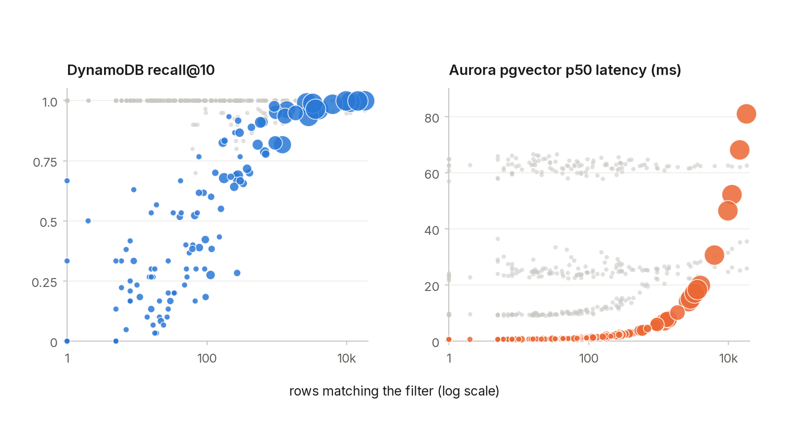
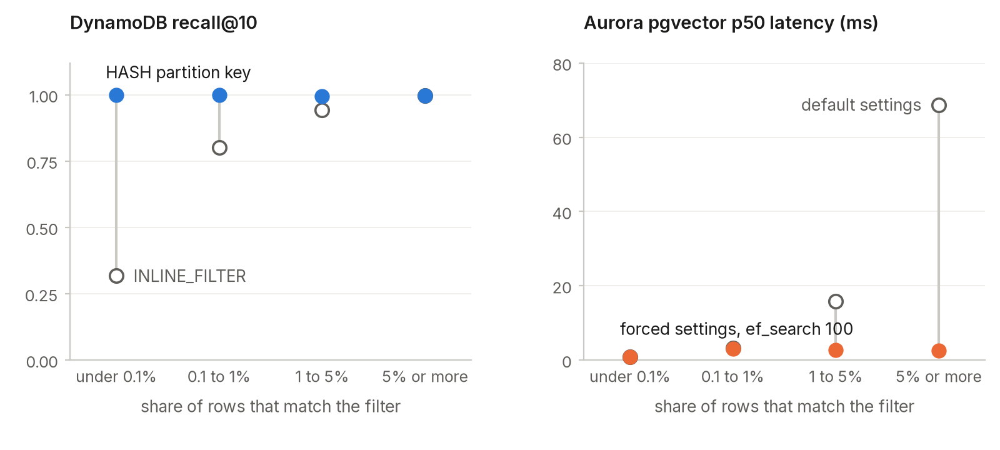
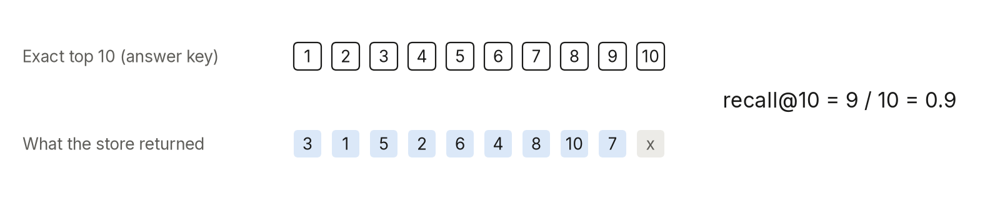
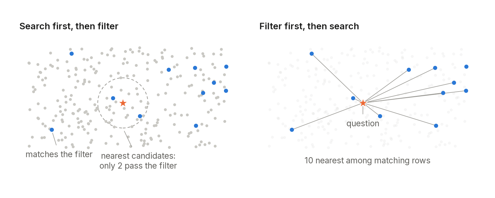
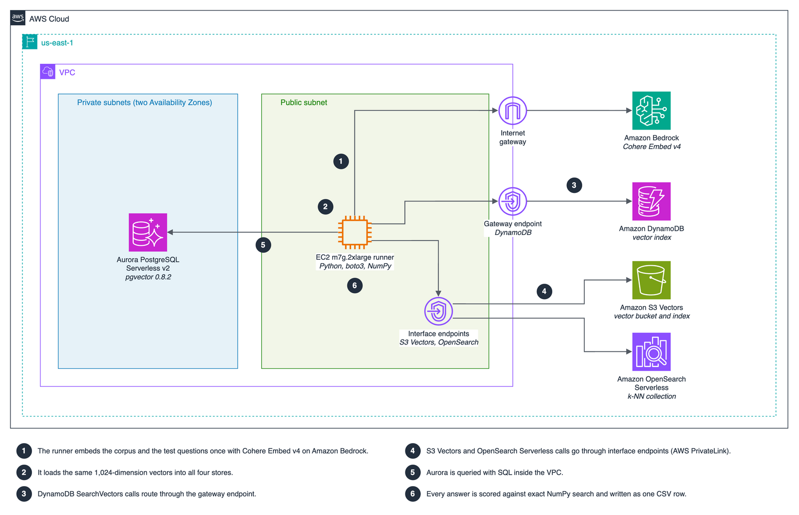
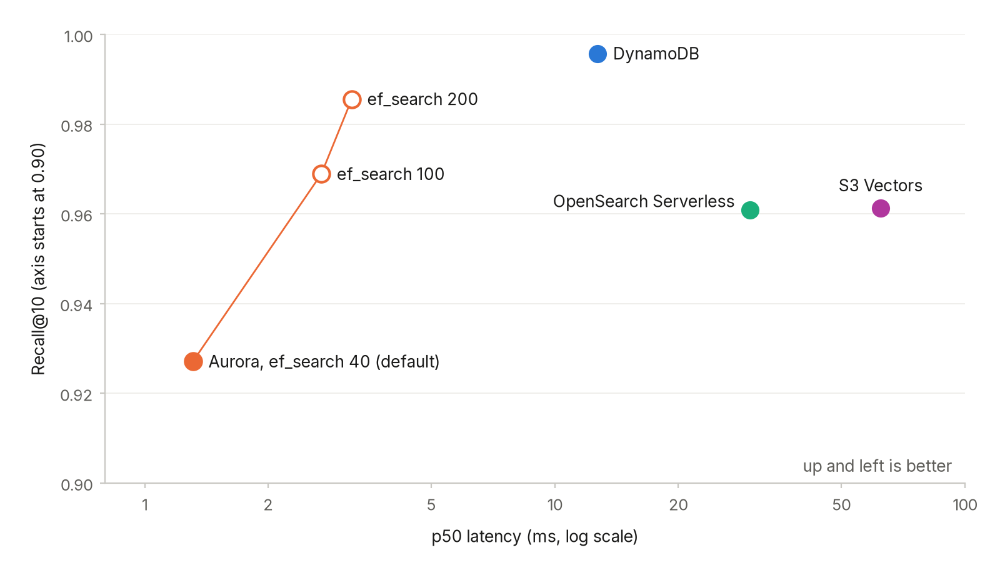
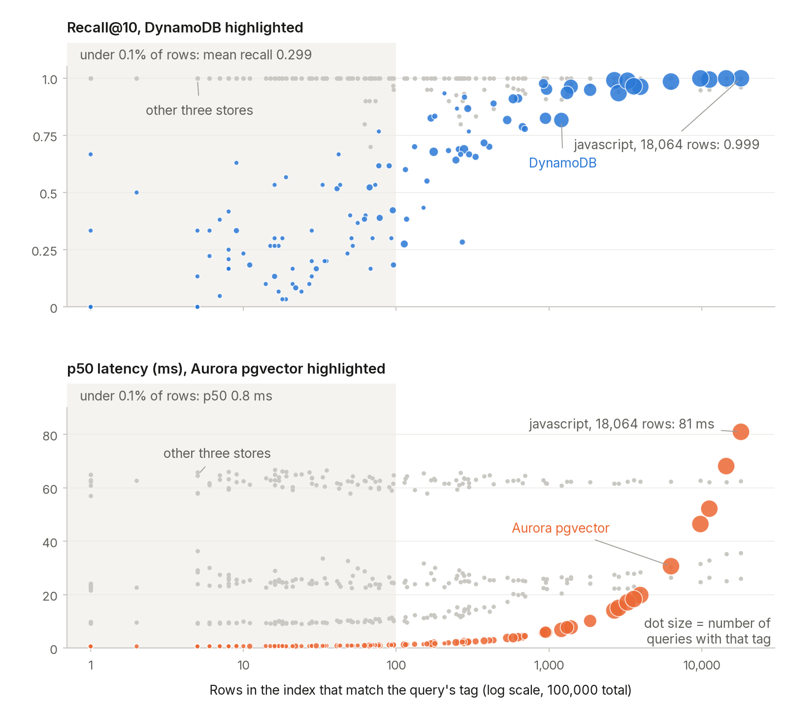
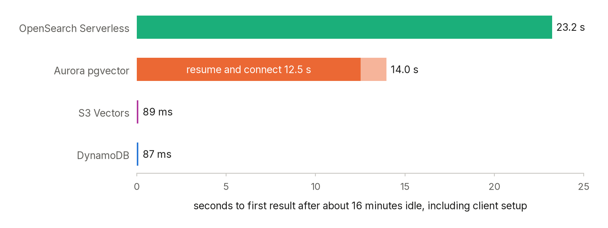

# Your average recall hides your smallest customer: build a filtered vector search test on AWS



Say you run a support assistant for a product with a few hundred customers. Every question is searched only against the asking customer's documents. Your biggest customer has 18,000 documents in the index, and your smallest has 40. Same code, same index, same embedding model. Does the small customer get results as complete as the big one, and as fast?

I built the same filtered search on four AWS stores to find out, with Stack Overflow tags in place of customers. The answer depended on the store. On the rarest tags, Amazon DynamoDB's mean recall@10 against exact search was 0.299; on the most common, 0.996. Aurora PostgreSQL with pgvector returned exact results for every tag, but its median latency went from 0.8 ms to 67.6 ms. The overall averages hid both effects. I then provisioned fresh resources and ran the benchmark again with this guide's code. That second build reproduced both effects, and each one has a fix: making the filter the partition key in DynamoDB restored recall on narrow filters, and three planner settings in Aurora cut latency on broad filters at slightly lower recall.

This guide walks through the build so you can run the same check on your data: create a vector index with a filterable attribute on each store, load the vectors, write the filtered query, score every answer against exact search, and group the scores by how many rows the filter matches. The code comes from a public repo, along with my request logs from both runs, so you can compare your numbers with mine.

## What you will build and what it found

- **What you build:** one vector index per store with a filterable attribute, the same filtered top-10 query for DynamoDB, Amazon S3 Vectors, Amazon OpenSearch Serverless and Aurora pgvector, and a test that scores each answer against an exact NumPy search and groups the scores by filter width.
- **What the test caught** on 100,000 Spanish Stack Overflow chunks, each query filtered by its own tag:

| Share of rows matching the filter | Aurora pgvector | DynamoDB | OpenSearch Serverless | S3 Vectors |
|---|---|---|---|---|
| under 0.1% (85 queries) | 1.000 recall, 0.8 ms | 0.299 recall, 9.7 ms | 1.000, 24.5 ms | 0.984, 62.4 ms |
| 5% or more (575 queries, 5 tags) | 1.000, 67.6 ms | 0.996, 25.7 ms | 0.999, 33.8 ms | 0.956, 62.4 ms |

*Mean recall@10 against exact search, p50 latency seen by the client.*

- **How to recover recall and cut latency:**
  - **DynamoDB (second build):** with the tag as the index's `HASH` partition key instead of an inline filter, recall on the narrowest filters went from 0.317 to 1.000.
  - **Aurora (second build):** turning off bitmap and sequential scans and forcing custom plans let broad filters use the HNSW index, with `hnsw.ef_search` at 100. The broadest bucket went from 68.8 ms to 2.5 ms p50, at 0.971 recall instead of exact, and narrow filters stayed exact.

  
- **Use it on your data:** count the rows behind each filter value before you test, then report recall and latency for your narrowest and broadest values next to the average. On my second corpus, Chilean law, no filter was narrow enough to show either effect.

## Background: vector search, recall and the four stores

If you already work with vector indexes, skip to the next section.

**Vector search.** An embedding model turns each piece of text into a list of numbers, 1,024 of them in this lab. Texts with similar meaning end up close together, so "find relevant documents" becomes "find the vectors closest to the question's vector". The exact way is to compare the question with every stored vector. That is too slow for large collections, so vector stores build an approximate index, such as the HNSW graph in pgvector, which visits only a small part of the data. Approximate search is fast, and it sometimes misses one of the true nearest neighbors.

Think of a library where books on the same subject sit near each other. You ask a librarian for the 10 books closest to your question. Exact search means the librarian checks every shelf. Approximate search means they check only some shelves, which is much faster and usually right, but now and then they miss a closer book.

**Recall@10.** Recall@10 measures how much an approximate search misses. Take the 10 true nearest neighbors from an exact search, and count how many of them the store returned. The order does not matter.



A recall of 0.9 means that on average 9 of the 10 came back. I report it next to latency because a faster search can miss more neighbors.

**Filtered search.** Real queries usually come with a condition: this tenant, this product, this tag. The store has to return the 10 nearest vectors among the rows that pass the filter. In the library, that is asking for the 10 closest books, but only ones in Portuguese. If the librarian picks the nearest books first and then drops the ones in other languages, a rare language can leave you with one or two books. If they first collect every Portuguese book and then rank them, you get a full answer, but the work grows with the number of Portuguese books.



*A drawing of two example strategies, not data: blue dots are rows that pass the filter, the star is the question. The three Aurora plans I captured used the second. DynamoDB's documentation says it applies inline filters during the search.*

Each store handles this its own way, which is why the test in this guide groups results by filter width. Aurora's query plan in Step 7 turns out to be the right-hand drawing.

**The four stores.** Each one adds vector search to a service many teams already run:

| Store | What it is | Available since |
|---|---|---|
|  DynamoDB vector search | A vector index on a DynamoDB table, queried with `SearchVectors` | [August 2026](https://aws.amazon.com/about-aws/whats-new/2026/08/amazon-dynamodb-vector-search/) |
|  Amazon S3 Vectors | Vector buckets and indexes inside S3, billed for storage, uploads and queries | [GA December 2025](https://aws.amazon.com/about-aws/whats-new/2025/12/amazon-s3-vectors-generally-available/) |
|  OpenSearch Serverless (next generation) | k-NN search on a `knn_vector` field in a serverless collection | [May 2026](https://aws.amazon.com/about-aws/whats-new/2026/05/amazon-opensearch-serverless-next-generation-generally-available/) |
|  Aurora PostgreSQL with pgvector | The pgvector extension: a `vector` column type and HNSW indexes, queried with SQL | pgvector 0.8 on Aurora since [April 2025](https://aws.amazon.com/about-aws/whats-new/2025/04/pgvector-0-8-0-aurora-postgresql/) |

Two of them, DynamoDB and S3 Vectors, have no servers or capacity to size. OpenSearch Serverless and Aurora Serverless v2 scale capacity units up and down and bill for them while they are awake, so delete them when you finish (Step 8).

## What you need



- **An AWS account and a region with all four services.** I used us-east-1. The repo's `infra/` folder is Terraform for the VPC, an EC2 runner, the S3 vector bucket and indexes, the OpenSearch Serverless collection and an Aurora Serverless v2 cluster. DynamoDB vector tables are created from Python, because Terraform could not create the vector index when I built this.
- **Python with** boto3 1.43.109, numpy, opensearch-py 3.2.0, psycopg 3.3.6 and the `pgvector` package. Those are the versions I ran; `runner/uv.lock` pins them all.
- **Embeddings for your documents and your test questions**, normalized to unit length, plus one filter value per document. I used Cohere Embed v4 on Amazon Bedrock at 1,024 dimensions, embedded everything once and loaded the same vectors into every store.
- **Outbound access to the DynamoDB search hostname.** `SearchVectors` goes to a separate search hostname: `search-dynamodb.us-east-1.amazonaws.com`, or the [account-based](https://docs.aws.amazon.com/amazondynamodb/latest/developerguide/VectorSearchWorkingWith.html#VectorSearchWorkingWith.Endpoints) `<account-id>.search-ddb.us-east-1.amazonaws.com` when the SDK uses account-based endpoints. Every other call goes to the usual DynamoDB hostname, so a hostname allowlist needs both search names. The [DynamoDB docs](https://docs.aws.amazon.com/amazondynamodb/latest/developerguide/VectorSearchTutorial.html) warn that a proxy or egress allowlist that only knows the main hostname lets table creation and writes through and fails only the searches. A DynamoDB gateway endpoint should still cover it: after the runs I resolved the search hostnames, and every address fell inside the `com.amazonaws.us-east-1.dynamodb` prefix list that the gateway endpoint adds to the route table. To check your region, compare `dig +short search-dynamodb.<region>.amazonaws.com` with the output of `aws ec2 get-managed-prefix-list-entries` for that prefix list.

The code below assumes three arrays for the documents and two lists for the questions:

```python
ids    # one string per chunk, e.g. "so-48213-2"
attrs  # numpy array of filter values, e.g. "javascript"
vecs   # float32 array, shape (n, 1024), each row unit length

query_vecs, query_tags  # one vector and one filter value per test question
```

And the names of what Terraform created, from `terraform output` in `infra/`:

```python
table = "fv-vec-so-cohere"           # DynamoDB table, created in Step 3
bucket = "<vector_bucket output>"    # S3 vector bucket
s3v_index = "so-cohere"              # S3 Vectors index
host = "<aoss_endpoint output, host part only>"
aoss_index = "so-cohere"             # OpenSearch index, created in Step 3
aurora_host = "<aurora_host output>"
aurora_secret_arn = "<aurora_secret_arn output>"   # Secrets Manager secret with the login
```

My data: 100,000 chunks of Spanish Stack Overflow answers (CC BY-SA, April 2024 data dump), where the filter is the first tag of the answer's question, and 1,000 question titles as queries, each filtered by its own tag. The second corpus is 8,851 chunks of Chilean law from Ley Chile, filtered by which of 11 texts a chunk comes from, with 1,000 questions generated by Claude Haiku 5.5.

## Step 1: Count how many rows each filter value matches

Do this before you create any index. The number of rows behind a filter value decides how much work a filtered search has to do, and it was the variable that split my results:

```python
import collections

rows_per_value = collections.Counter(attrs)
matching = [rows_per_value[tag] for tag in query_tags]   # one count per test query

def bucket_of(n, total=len(attrs)):
    share = n / total
    return "<0.1%" if share < 0.001 else "0.1-1%" if share < 0.01 else "1-5%" if share < 0.05 else ">=5%"

print(collections.Counter(bucket_of(n) for n in matching))
```

My Stack Overflow corpus had 759 tags, from `javascript` with 18,064 chunks down to tags with a single chunk, and my 1,000 test queries landed in all four buckets, with 85 in the narrowest. Ley Chile's narrowest filter matched 259 of 8,851 chunks (2.9%), so its queries filled only two buckets. If your test queries miss a bucket your users will hit, add queries for it before you go on. In the support assistant, the narrowest bucket is your smallest customers.

## Step 2: Build an exact answer key

Recall needs a right answer to compare against. With 100,000 vectors of 1,024 floats, brute force fits in memory and takes seconds. These are the two functions from `runner/fv/vec.py`, plus the lines that call them:

```python
import numpy as np

def exact_topk(q, base, k, allowed=None):
    """Brute-force cosine top-k; q and base rows are unit-length."""
    scores = base @ q
    k = min(k, len(scores))
    if allowed is not None:                      # filtered truth: rows that fail the filter can't win
        scores = np.where(allowed, scores, -np.inf)
        k = min(k, int(allowed.sum()))
    if k == 0:
        return np.array([], dtype=np.int64)
    idx = np.argpartition(-scores, k - 1)[:k]
    return idx[np.argsort(-scores[idx])]

def recall_at_k(found, truth, k):
    want = truth[:k]
    if not want:
        return float("nan")
    return len(set(found[:k]) & set(want)) / len(want)

truth_plain = [[ids[i] for i in exact_topk(q, vecs, 10)] for q in query_vecs]
truth_filter = [[ids[i] for i in exact_topk(q, vecs, 10, attrs == tag)]
                for q, tag in zip(query_vecs, query_tags)]
```

When a filter value has fewer than 10 rows, the denominator is the number of rows that exist, so a store is never charged for neighbors that cannot exist. This recall measures how faithful each store is to exact search over the same vectors. Whether the answers help a human is a separate question that needs its own evaluation.

## Step 3: Create the index and load the vectors

Each store needs the filter attribute declared or stored in a way it can filter on. These snippets are adapted from `runner/fv/stores/`.

**DynamoDB.** The vector index lives on an on-demand table. The filter attribute goes both in `AttributeDefinitions` and in the index's search schema as an `INLINE_FILTER`:

```python
import time
import boto3

ddb = boto3.client("dynamodb", region_name="us-east-1")

ddb.create_table(
    TableName=table, BillingMode="PAY_PER_REQUEST",
    AttributeDefinitions=[{"AttributeName": "id", "AttributeType": "S"},
                          {"AttributeName": "attr", "AttributeType": "S"}],
    KeySchema=[{"AttributeName": "id", "KeyType": "HASH"}],
    VectorIndexes=[{
        "IndexName": "vec", "VectorAttribute": {"AttributeName": "v"},
        "Dimensions": 1024, "DistanceFunction": "COSINE",
        "Projection": {"ProjectionType": "ALL"},
        "SearchSchema": [{"AttributeName": "attr", "SearchSchemaElementType": "INLINE_FILTER"}],
    }],
)
ddb.get_waiter("table_exists").wait(TableName=table)

def put(batch):                                   # retry what DynamoDB could not write yet
    pending, delay = {table: batch}, 0.05
    while pending:
        pending = ddb.batch_write_item(RequestItems=pending).get("UnprocessedItems")
        if pending:
            time.sleep(delay)
            delay = min(delay * 2, 2)

batch = []
for id_, attr, v in zip(ids, attrs, vecs):
    batch.append({"PutRequest": {"Item": {
        "id": {"S": id_}, "attr": {"S": str(attr)},
        "v": {"L": [{"N": repr(float(x))} for x in v]}}}})
    if len(batch) == 25:                          # BatchWriteItem takes 25 items per call
        put(batch)
        batch = []
if batch:
    put(batch)
```

Then wait for the index to finish building:

```python
def wait_for_index(table):
    while True:
        idx = ddb.describe_table(TableName=table)["Table"].get("VectorIndexes", [])
        if idx and all(i["IndexStatus"] == "ACTIVE" and not i.get("Backfilling") for i in idx):
            return
        time.sleep(30)

wait_for_index(table)
```

Even then, the first searches can fail with `ValidationException` for a short while, so retry them before you start timing.

On the EC2 runner, this sequential loop took about 14.5 minutes for 100,000 items. Run several loops in parallel threads if that is too slow.

**S3 Vectors.** I created the vector bucket and index with Terraform. Metadata keys are filterable unless you list them as non-filterable, so `attr` needs no declaration:

```hcl
resource "aws_s3vectors_index" "lab" {
  vector_bucket_name = aws_s3vectors_vector_bucket.lab.vector_bucket_name
  index_name         = "so-cohere"
  data_type          = "float32"
  dimension          = 1024
  distance_metric    = "cosine"
  metadata_configuration {
    non_filterable_metadata_keys = ["doc_id"]   # declared for the repo's join case; never filtered on
  }
}
```

Loading takes up to 500 vectors per `PutVectors` call:

```python
s3v = boto3.client("s3vectors", region_name="us-east-1")

for i in range(0, len(ids), 500):
    s3v.put_vectors(vectorBucketName=bucket, indexName=s3v_index, vectors=[
        {"key": id_, "data": {"float32": v.tolist()}, "metadata": {"attr": str(attr)}}
        for id_, attr, v in zip(ids[i:i + 500], attrs[i:i + 500], vecs[i:i + 500])])
```

**OpenSearch Serverless.** Terraform creates a `VECTORSEARCH` collection (next generation) with its encryption, network and data access policies. The index and the load are Python. I set `compression_level` to `1x`, so OpenSearch searches full-precision vectors like the other three, and mapped `attr` as a `keyword` so a `term` filter can match it. The SigV4 service name is `aoss`.

```python
from opensearchpy import AWSV4SignerAuth, OpenSearch, RequestsHttpConnection, helpers

auth = AWSV4SignerAuth(boto3.Session().get_credentials(), "us-east-1", "aoss")
os_client = OpenSearch(hosts=[{"host": host, "port": 443}], http_auth=auth,
                       use_ssl=True, connection_class=RequestsHttpConnection, timeout=120)

os_client.indices.create(index=aoss_index, body={
    "settings": {"index": {"knn": True}},
    "mappings": {"properties": {
        "v": {"type": "knn_vector", "dimension": 1024,
              "space_type": "cosinesimil", "compression_level": "1x"},
        "attr": {"type": "keyword"}}}})

helpers.bulk(os_client, ({"_index": aoss_index, "_id": id_,
                          "_source": {"v": v.tolist(), "attr": str(attr)}}
                         for id_, attr, v in zip(ids, attrs, vecs)),
             chunk_size=200, max_retries=5)
```

Loading took about 3.5 minutes for S3 Vectors, and 5 minutes for OpenSearch including the wait until every document was searchable. New documents take a while to become searchable, so poll `os_client.count(index=aoss_index)` until it reaches the number you loaded.

**Aurora pgvector.** A table with a `vector` column, loaded with binary `COPY`, and indexes built after the load. With psycopg, register the vector type and pass a `Vector`, or a Python list is sent as a Postgres array:

```python
import json
import psycopg
from pgvector import Vector
from pgvector.psycopg import register_vector

login = json.loads(boto3.client("secretsmanager", region_name="us-east-1")
                   .get_secret_value(SecretId=aurora_secret_arn)["SecretString"])
user, password = login["username"], login["password"]

conn = psycopg.connect(host=aurora_host, dbname="postgres", user=user, password=password,
                       sslmode="require", connect_timeout=30, autocommit=True)
conn.execute("CREATE EXTENSION IF NOT EXISTS vector")
conn.execute("ALTER EXTENSION vector UPDATE")   # iterative scans need 0.8 or later; I ran 0.8.2
register_vector(conn)
conn.execute("CREATE TABLE so_chunks (id text PRIMARY KEY, attr text, v vector(1024))")

with conn.cursor() as cur, cur.copy("COPY so_chunks (id, attr, v) FROM STDIN WITH (FORMAT BINARY)") as cp:
    cp.set_types(["text", "text", "vector"])
    for id_, attr, v in zip(ids, attrs, vecs):
        cp.write_row((id_, str(attr), Vector(v)))

conn.execute("SET maintenance_work_mem = '1GB'")
conn.execute("CREATE INDEX ON so_chunks USING hnsw (v vector_cosine_ops) WITH (m = 16, ef_construction = 64)")
conn.execute("CREATE INDEX ON so_chunks (attr)")
conn.execute("ANALYZE so_chunks")
```

The whole routine, from creating the table to `ANALYZE`, took about 2 minutes for 100,000 rows.

## Step 4: Write the filtered query

The filter is an equality on `attr`. Each function returns the ids of the top 10:

```python
def query_ddb(vec, tag):
    r = ddb.search_vectors(
        TableName=table, IndexName="vec", TopK=10,
        SearchVector=[{"N": repr(float(x))} for x in vec],
        SearchConditionExpression="#a = :a",
        ExpressionAttributeNames={"#a": "attr"},
        ExpressionAttributeValues={":a": {"S": tag}},
        ProjectionExpression="id")
    return [h["Item"]["id"]["S"] for h in r["SearchResults"]]

def query_s3v(vec, tag):
    r = s3v.query_vectors(
        vectorBucketName=bucket, indexName=s3v_index, topK=10,
        queryVector={"float32": [float(x) for x in vec]},
        filter={"attr": {"$eq": tag}}, queryMode="ENHANCED")   # filter before the search
    return [v["key"] for v in r["vectors"]]

def query_aoss(vec, tag):
    r = os_client.search(index=aoss_index, body={
        "size": 10, "_source": False,
        "query": {"knn": {"v": {"vector": [float(x) for x in vec], "k": 10,
                                "filter": {"term": {"attr": tag}}}}}})
    return [h["_id"] for h in r["hits"]["hits"]]

conn.execute("SET hnsw.iterative_scan = relaxed_order")   # keep scanning, within pgvector's scan limits, until 10 rows pass

def query_aurora(vec, tag):
    return [row[0] for row in conn.execute(
        "SELECT id FROM so_chunks WHERE attr = %s ORDER BY v <=> %s LIMIT 10",
        (tag, Vector(vec))).fetchall()]
```

The snippets in this guide are collected in `article/verify/guide_check.py` in the repo, and the second-build numbers come from running that script against freshly provisioned resources. Before you time anything, call each function once with a common filter value and check that it returns 10 ids and that every id has that value in `attrs`.

Details to get right:

- In S3 Vectors, a filter or `returnMetadata=True` also needs `s3vectors:GetVectors` in the IAM policy, or the query fails with a 403.
- In Aurora, [iterative index scans](https://github.com/pgvector/pgvector/tree/v0.8.2#iterative-index-scans) arrived in pgvector 0.8 and are off by default. With `relaxed_order`, results can come back slightly out of order, which does not affect recall@10.
- In DynamoDB, `TopK` is capped at 100. Until [November 20, 2026](https://aws.amazon.com/about-aws/whats-new/2026/11/dynamodb-vector-filters/), inline filters accepted only `=`; that release added `IN`, `<`, `<=`, `>`, `>=` and `BETWEEN` on numbers, `AND`, `OR` and `NOT`, and `attribute_exists` and `attribute_not_exists`. The current [operator reference](https://docs.aws.amazon.com/amazondynamodb/latest/developerguide/VectorSearchFilterReference.html#VectorSearchFilterReference.Operators) also lists `<>`; `=`, `<>` and `IN` work on any type, and the range operators on numbers only. I tested `=` only. To test a range such as `#price BETWEEN :lo AND :hi`, declare `price` as a Number inline filter and use the same inclusive bounds in the answer key (`allowed = (lo <= prices) & (prices <= hi)`) and in the Step 1 count. A `HASH` element in the search schema still accepts only `=`.

## Step 5: Time each request and keep every row

Run one query at a time from a machine close to the stores. I used an EC2 `m7g.2xlarge` in the same region and VPC, reaching S3 Vectors and OpenSearch through PrivateLink. One sequential client measures latency per request; it does not measure throughput. Send 20 warm-up queries per store, then make 3 passes over the test queries and write one CSV row per request. This is the loop from `runner/fv/harness.py`, simplified:

```python
import csv, time

stores = {"ddb": query_ddb, "s3v": query_s3v, "aoss": query_aoss, "aurora": query_aurora}

with open("requests.csv", "w", newline="") as f:
    writer = csv.writer(f)
    writer.writerow(["store", "rep", "qi", "latency_ms", "recall", "ok", "error"])
    for name, query in stores.items():
        for vec, tag in list(zip(query_vecs, query_tags))[:20]:
            try:
                query(vec, tag)                               # warm-up, not recorded
            except Exception as e:
                print(name, "warm-up failed:", e)
        for rep in range(1, 4):
            for qi, (vec, tag) in enumerate(zip(query_vecs, query_tags)):
                t0 = time.perf_counter()
                try:
                    got = query(vec, tag)
                    ms = (time.perf_counter() - t0) * 1000
                    writer.writerow([name, rep, qi, ms, recall_at_k(got, truth_filter[qi], 10), True, ""])
                except Exception as e:                        # recorded, never silently fast
                    ms = (time.perf_counter() - t0) * 1000
                    writer.writerow([name, rep, qi, ms, "", False, f"{type(e).__name__}: {e}"])
```

Run the same loop a second time without the filter, against `truth_plain`, and write it to its own CSV, so you know what the filter adds. For that run, remove the filter from each query: the DynamoDB condition fields, the S3 Vectors `filter` and `queryMode`, the OpenSearch `filter`, and the Aurora `WHERE` clause. Use the `INLINE_FILTER` table for DynamoDB, since a `HASH` index needs its condition on every search. The first build's final benchmark made 72,000 timed requests with zero errors, across four stores, two corpora and three query cases. Keeping one row per request mattered later: I found the filter-width effect weeks after the lab, in the same CSVs, without running anything new.

## Step 6: Group the results by filter width

Start with the averages. Without a filter, on Stack Overflow:



| Store | p50 | p95 | Recall@10 |
|---|---|---|---|
| Aurora pgvector (`ef_search` 40, the default) | 1.31 ms | 1.61 ms | 0.927 |
| DynamoDB | 12.72 ms | 14.60 ms | 0.996 |
| OpenSearch Serverless | 29.95 ms | 41.08 ms | 0.961 |
| S3 Vectors | 62.27 ms | 67.27 ms | 0.961 |

Aurora's low recall comes from pgvector's default `hnsw.ef_search` of 40. At 200, Aurora reached 0.986 recall at 3.20 ms p50. At 100 the p50 was 2.70 ms and the p95 jumped to 110 ms, which I did not investigate. DynamoDB's 0.996 meets the recall in the launch announcement, "[single-digit millisecond latency at 99%+ recall](https://aws.amazon.com/about-aws/whats-new/2026/08/amazon-dynamodb-vector-search/)"; my 12.7 ms p50 is measured at the client and includes the round trip.

With the filter, across all 1,000 queries: Aurora 46.14 ms p50 at 1.000 recall, DynamoDB 24.18 ms at 0.899, OpenSearch 30.89 ms at 0.9996, S3 Vectors 62.39 ms at 0.958. A mean as low as DynamoDB's 0.899 usually hides a group of queries doing much worse, so join the Step 1 counts to the request rows:

```python
import collections, csv, math, statistics

groups = collections.defaultdict(lambda: ([], []))
for r in csv.DictReader(open("requests.csv")):
    if r["ok"] == "True" and not math.isnan(float(r["recall"])):   # skip queries with no possible neighbors
        recalls, latencies = groups[(r["store"], bucket_of(matching[int(r["qi"])]))]
        recalls.append(float(r["recall"]))
        latencies.append(float(r["latency_ms"]))

for (store, b), (recalls, latencies) in sorted(groups.items()):
    print(store, b, round(statistics.mean(recalls), 3), round(statistics.median(latencies), 1))
```

Also count the rows where `ok` is not `True` in each bucket. A store that fails more often can look faster if you only keep the successes; my runs had none.

Plotted per tag, with one dot per store per tag, my results looked like this:



*Stack Overflow, 116 tags. For the highlighted store, dot size is the number of queries with that tag (capped). The other three stores are small grey dots.*

Two tags show the extremes. `asp.net` matches 250 rows and appears in one query. `javascript` matches 18,064 rows and appears in 156 queries.

| | `asp.net` (250 rows) | `javascript` (18,064 rows) |
|---|---|---|
| Aurora pgvector | 1.000 recall, 2.1 ms | 1.000 recall, 81.0 ms |
| DynamoDB | 0.867 recall, 15.3 ms | 0.999 recall, 26.0 ms |
| OpenSearch Serverless | 1.000, 27.1 ms | 0.997, 35.6 ms |
| S3 Vectors | 1.000, 59.4 ms | 0.960, 62.6 ms |

*Each column covers every request for that tag (3 for `asp.net`, 468 for `javascript`): mean recall, p50 latency.*

What each store did:

- **DynamoDB lost neighbors on narrow filters.** For tags matching under 0.1% of the rows, mean recall was 0.299. Some of those tags have fewer than 10 rows, so I checked the 62 queries with at least 10 matching rows separately: 0.323. The same `asp.net` query scored 0.9, 0.7 and 1.0 on its three passes, so one query also varies between runs. The AWS documentation says DynamoDB "[skips vectors that don't match your filter as it searches the index](https://docs.aws.amazon.com/amazondynamodb/latest/developerguide/VectorSearch.html)", and the search is approximate. I don't know why rare filters lose neighbors, but the fix below worked.
- **Aurora slowed down on broad filters.** Recall stayed at 1.000 while p50 went from 0.8 ms to 67.6 ms across the buckets. Raising `ef_search` did not change filtered queries: 46.14, 46.29 and 46.33 ms p50 at 40, 100 and 200. Step 7 shows why.
- **OpenSearch and S3 Vectors changed least.** OpenSearch kept recall at about 1.0 while p50 rose from 24.5 to 33.8 ms. S3 Vectors stayed between 62.3 and 62.6 ms p50 in every bucket, with mean recall between 0.950 and 0.984.

### The DynamoDB fix: make the filter the partition key

A `HASH` element in the search schema makes the attribute a [vector index partition key](https://docs.aws.amazon.com/amazondynamodb/latest/developerguide/VectorSearchBestPractices.html#VectorSearchBestPractices.PartitionKey): each search covers only the vectors with one value of it. The table definition changes in one word, and the query does not change at all:

```python
"SearchSchema": [{"AttributeName": "attr", "SearchSchemaElementType": "HASH"}],
```

To measure the difference, load the same 100,000 vectors into two tables, one with `attr` as `INLINE_FILTER` and one with `attr` as `HASH`, and run the same 3 passes over the 1,000 filtered queries against both. The Step 4 query works unchanged on both, since the same `SearchConditionExpression` serves an inline filter and a partition key; only the table name changes (`query_ddb_on(name)` in `guide_check.py`):

| Share of rows matching the filter | `INLINE_FILTER` | `HASH` |
|---|---|---|
| under 0.1% (85 queries) | 0.317 recall, 9.6 ms | 1.000 recall, 13.8 ms |
| 0.1% to 1% (125 queries) | 0.802, 19.8 ms | 1.000, 10.4 ms |
| 1% to 5% (215 queries) | 0.942, 29.3 ms | 0.996, 17.4 ms |
| 5% or more (575 queries) | 0.997, 33.4 ms | 0.998, 23.1 ms |
| all queries | 0.903, 31.5 ms | 0.998, 20.8 ms |

*Second build. Mean recall@10, p50 latency, 3,000 requests per table, zero errors.*

The partition key comes with rules. Every search has to include exactly one `=` condition on it, at the top level and joined to any other conditions with `AND`, so you cannot search across all tags or combine two tags with `OR` in one call ([partition key rules](https://docs.aws.amazon.com/amazondynamodb/latest/developerguide/VectorSearchFilterReference.html#VectorSearchFilterReference.PartitionKey)). You also cannot add a partition key to an existing vector index; it takes a new index ([troubleshooting](https://docs.aws.amazon.com/amazondynamodb/latest/developerguide/VectorSearchTroubleshooting.html)). AWS cautions against both cardinality extremes, with a unique item id as its example of too high. My 759 tags, many with a single row, still scored 1.000 on the narrowest bucket, measured against exact search within the tag. In the support assistant, the customer id is the natural partition key, because every question is already scoped to one customer. AWS [notes two things](https://docs.aws.amazon.com/amazondynamodb/latest/developerguide/VectorSearchWorkingWith.html#VectorSearchWorkingWith.Search.Filtering) to plan for: the partition key is not an access-control boundary, since any caller with `dynamodb:SearchVectors` on the index can search any value, and an item written without the attribute is left out of the index without an error.

For the other stores, the second build reproduced the first within a few milliseconds: Aurora went from 0.6 ms to 67.5 ms across the buckets at 1.000 recall, OpenSearch stayed between 22.7 and 29.4 ms at 1.000, and S3 Vectors stayed between 61.8 and 62.4 ms at 0.933 to 0.985. DynamoDB with the inline filter was slower than in the first build (31.5 ms p50 overall against 24.2 ms), with the same recall pattern.

On Ley Chile, with only the two broad buckets, Aurora's p50 rose from 1.8 to 4.8 ms, S3 Vectors' recall moved from 0.943 to 0.961, and DynamoDB stayed at 0.999 or higher. Had I tested only that corpus, I would have concluded that filter width barely matters.

## Step 7: When latency jumps, read the plan

For Aurora, `EXPLAIN (ANALYZE, BUFFERS)` shows what the filter does. Run it on one narrow and one broad filter value, and once without a filter:

```python
plan = conn.execute(
    "EXPLAIN (ANALYZE, BUFFERS) SELECT id FROM so_chunks WHERE attr = %s ORDER BY v <=> %s LIMIT 10",
    ("javascript", Vector(query_vecs[0]))).fetchall()
print("\n".join(row[0] for row in plan))
```

Without a filter, Postgres walked the HNSW index and finished in 0.7 to 1.9 ms on my first three queries. With a filter, all three plans used the B-tree index on `attr` to find every matching row, computed the distance for each one, and kept the top 10 with a heapsort. This is the `javascript` plan from the first build, `results/2026-10-09/aurora-explain.json`, where the table was named `so_cohere_chunks` and its tag index `so_cohere_chunks_attr`; I removed cost estimates, planning lines and the query vector:

```text
Limit  (actual time=83.797..83.800 rows=10 loops=1)
  Buffers: shared hit=79245
  ->  Sort  (actual time=83.796..83.797 rows=10 loops=1)
        Sort Key: ((v <=> '[...]'::vector))
        Sort Method: top-N heapsort  Memory: 25kB
        ->  Bitmap Heap Scan on so_cohere_chunks  (actual time=0.411..81.447 rows=18064 loops=1)
              Recheck Cond: (attr = 'javascript'::text)
              Heap Blocks: exact=977
              ->  Bitmap Index Scan on so_cohere_chunks_attr  (actual time=0.316..0.316 rows=18064 loops=1)
                    Index Cond: (attr = 'javascript'::text)
Execution Time: 83.829 ms
```

What to look for:

- **Which index it used.** A `Bitmap Index Scan` on the `attr` index means an exact scan of every matching row. An `Index Scan` on the HNSW index means approximate search. The plans I captured with a filter never touched the HNSW index, which explains why `ef_search` changed nothing, and exact 1.000 recall on all 3,000 filtered requests is consistent with the same plan for the rest.
- **Rows and buffers.** For `asp.net`: 250 rows, 1,272 shared-buffer hits, 1.5 ms. For `javascript`: 18,064 rows, 79,245 shared-buffer hits, 83.8 ms, of which 81.4 ms went to the bitmap heap scan that fetches the matching rows. That is about 4.4 shared-buffer hits per matching row, over 977 heap blocks. My guess, which I have not tested: each 1,024-dimension vector is about 4 KB, larger than Postgres keeps inline, so every row read also reads the vector out of line.

This plan is fast for selective filters and slow for broad ones. To fix the broad case, take the most common tag, `javascript`, and time its 468 requests (156 queries, 3 passes) after each change:

| Change | Plan in an `EXPLAIN` before the timed loop | Recall@10 | p50 |
|---|---|---|---|
| none | bitmap scan on `attr`, exact sort | 1.000 | 84.1 ms |
| partial HNSW index `WHERE attr = 'javascript'` | the same bitmap scan; the planner ignored the new index | 1.000 | 84.6 ms |
| `enable_bitmapscan = off`, no partial index | sequential scan, exact sort | 1.000 | 84.5 ms |
| partial index, bitmap and sequential scans off | partial HNSW index (1.1 ms), yet the timed loop stayed slow | 1.000 | 81.1 ms |
| the same, plus `plan_cache_mode = force_custom_plan` | partial HNSW index | 0.958 | 1.1 ms |
| the same, with `hnsw.ef_search = 100` | partial HNSW index | 0.988 | 1.9 ms |

In the fourth row, `EXPLAIN` shows the fast plan, yet the timed loop stays slow. psycopg [prepares a statement on the server](https://www.psycopg.org/psycopg3/docs/advanced/prepare.html) once the same query has run more than 5 times on a connection (the default `prepare_threshold`), and after five executions of a prepared statement, Postgres [may switch to a generic plan](https://www.postgresql.org/docs/17/sql-prepare.html) where the tag is a parameter (`$1`). A generic plan cannot prove that `$1` equals `'javascript'`, so it cannot use an index with `WHERE attr = 'javascript'`. I did not capture the plan inside the timed loop, but forcing a custom plan for every execution made the loop fast. This is what I ran:

```python
conn.execute("SET maintenance_work_mem = '1GB'")
conn.execute("CREATE INDEX so_chunks_js_hnsw ON so_chunks USING hnsw (v vector_cosine_ops) "
             "WITH (m = 16, ef_construction = 64) WHERE attr = 'javascript'")
conn.execute("ANALYZE so_chunks")
conn.execute("SET enable_bitmapscan = off")
conn.execute("SET enable_seqscan = off")
conn.execute("SET plan_cache_mode = force_custom_plan")   # let the planner see the literal tag
conn.execute("SET hnsw.ef_search = 100")                  # 0.988 recall at 1.9 ms p50
```

The partial index took 11 seconds to build for 18,064 rows.

Planner settings apply to every query on the connection, so check what they do to the other tags. On a fresh cluster, with the `javascript` partial index in place, I ran all 1,000 filtered queries with default settings, then again with the four settings above on the session:

| Share of rows matching | Default settings | Forced settings, `ef_search` 100 |
|---|---|---|
| under 0.1% | 1.000 recall, 0.9 ms | 1.000, 0.9 ms |
| 0.1% to 1% | 1.000, 3.2 ms | 1.000, 3.0 ms |
| 1% to 5% | 1.000, 15.8 ms | 0.975, 2.7 ms |
| 5% or more | 1.000, 68.8 ms | 0.971, 2.5 ms |
| all queries | 1.000, 47.3 ms (p95 85.9 ms) | 0.978, 2.5 ms (p95 7.2 ms) |

Narrow tags stayed exact: in `EXPLAIN`, `asp.net` still read its 250 rows through the `attr` index. Broad tags without a partial index, such as `python` with 9,801 rows, switched to the table-wide HNSW index with iterative scan (1.9 ms in `EXPLAIN`). I did not time `javascript` without its partial index under these settings, but the other broad tags got similar speed from the table-wide index, so for this data the partial index looks optional and the planner settings do most of the work. The cost is on broad filters, which give up exact results: mean recall was 0.975 and 0.971 in the two broad buckets, and individual tags ranged from 0.956 (`php`) to 0.989 (`javascript`).

To keep the settings away from other queries on the same connection, scope them to one transaction instead of setting them on the session. Use a connection without the session-level `SET`s above (only `hnsw.iterative_scan = relaxed_order`), because at commit Postgres restores whatever the connection had before. For one query `vec, tag`:

```python
with conn.transaction():
    for s in ("enable_bitmapscan = off", "enable_seqscan = off",
              "plan_cache_mode = force_custom_plan", "hnsw.ef_search = 100"):
        conn.execute(f"SET LOCAL {s}", prepare=False)   # keep SET out of psycopg's prepared-statement cache
    hits = [row[0] for row in conn.execute(
        "SELECT id FROM so_chunks WHERE attr = %s ORDER BY v <=> %s LIMIT 10",
        (tag, Vector(vec))).fetchall()]
```

I timed that on the `javascript` queries. Recall matched the session version (0.957 against 0.958 at `ef_search` 40, 0.988 at 100), the connection's settings were back to their defaults afterwards, and p50 was 5.1 and 5.9 ms instead of 1.1 and 1.9 ms, because each query also sends a `BEGIN`, four `SET` statements and a `COMMIT`. Partitioning the table by tag is the other fix I would try, and I have not measured it.

## Step 8: Measure idle time, then clean up

A support assistant has quiet hours, so time the first search after a pause too. I did one trial per store after about 16 minutes without traffic.



The time to the first result, including client setup, was 23.2 s on OpenSearch Serverless and 14.0 s on Aurora (12.5 s to resume and connect, then 1.5 s for the query). DynamoDB took 87 ms and S3 Vectors 89 ms. With one trial each, treat these as an order of magnitude.

I set Aurora to auto-pause after 10 idle minutes. OpenSearch Serverless next generation [scales to zero](https://docs.aws.amazon.com/opensearch-service/latest/developerguide/serverless-scale-to-zero.html) after 10 idle minutes, a period you cannot change, and AWS documents 10 to 30 seconds for the first request afterwards. Traffic every few minutes keeps both awake all month. Held at the capacity I measured, a month awake projects to the figures below. The lower Aurora figure is one sample on the small corpus, so measure awake hours and capacity under your own traffic:

| Store | Capacity while serving | Monthly compute (730 h, list price) |
|---|---|---|
| Aurora pgvector | 2.84 ACU on the 100,000-vector bench (0.67 ACU in one sample on the small Ley bench) | about USD 249 (about USD 59 at 0.67 ACU) |
| OpenSearch Serverless | 1 search OCU | USD 175.20, search compute only |
| DynamoDB | pay per request | no compute floor |
| S3 Vectors | pay per request | no compute floor |

Storage is billed separately for all four. When you finish, delete the DynamoDB vector tables (`ddb.delete_table(TableName=table)`, plus the `HASH` table if you built one; the repo's `fv ddb-delete --all` deletes every `fv-vec-*` table), then destroy the Terraform stack: `terraform destroy` in `infra/`, or the repo's GitHub Actions workflow with `gh workflow run infra.yml -f action=destroy`.

## How I would choose now

These come from 100,000 vectors, equality filters and one sequential client. They are what I would test first on a new project.

- If you want SQL around the search, I would test Aurora pgvector first and run `EXPLAIN` on the broadest filter value you have. If broad filters are slow, I would try the Step 7 planner settings and accept slightly lower recall on them.
- If traffic is spiky or rare and you want no compute floor, I would test DynamoDB. If every query supplies one value of the filter, such as a customer id, I would make it the `HASH` partition key from the start.
- If filters come in every width and recall has to stay near 1.0, I would test OpenSearch Serverless, if the always-on cost fits.
- For large, cold collections where about 60 ms is fine, I would test S3 Vectors, which behaved the same across filter widths.

## Run it from the repo

Provisioning is a GitHub Actions workflow, `.github/workflows/infra.yml`, that runs the Terraform in `infra/`. It needs a state bucket and a GitHub OIDC role, which `infra/bootstrap` creates once in your account; set `AWS_ROLE_ARN` and `TF_STATE_BUCKET` in your fork from its outputs. On the runner, clone the repo, run `uv sync --frozen` in `runner/`, and prepare the corpus from the extracted Spanish Stack Overflow dump with `uv run fv so-prepare --dump <dir>`. On the EC2 runner, Terraform writes its outputs to `FV_*` environment variables. Off the runner, the CLI refuses to start unless `AWS_PROFILE` is one of the profile names in `LAB_PROFILES` in `runner/fv/config.py`, a guard I use to keep it off client accounts, so put your own profile name there. The core loop, from `runner/`:

```bash
uv run fv embed --corpus so --model cohere                                      # embeddings
uv run fv truth --corpus so --model cohere                                      # Step 2
for s in ddb s3v aoss aurora; do
  uv run fv load  --store $s --corpus so --model cohere                         # Step 3
  uv run fv bench --store $s --corpus so --model cohere --case filter --reps 3  # Steps 4 and 5
done
```

`article/verify/guide_check.py` is this guide's code in one script. It expects the lab runner (`FV_RUNNER=1`, the `FV_*` variables and the corpus under `FV_DATA_DIR`), and it reuses a cached answer key by file name, so use a separate `FV_DATA_DIR` per corpus and embedding run. `load` and `aurora_scope.py` drop and recreate `so_chunks`, so point them at a lab database. `load` creates and fills all four stores plus the `HASH` table, `bench` runs Steps 4 to 6, and `aurora` runs the first Step 7 changes; `aurora_force.py` and `aurora_scope.py` in the same folder run the rest. Their request CSVs, plans and logs are in `results/2026-11-24/`.

To check the first build's tables without an AWS account, the analysis script regenerates the baseline, `ef_search` sweep, filter-width and two-tag tables from the committed request CSVs, with Python's standard library:

```bash
git clone https://github.com/andrezc98/fast-and-vectorious
cd fast-and-vectorious
python3 article/analysis.py
```

The cold-start and cost figures come from `results/2026-10-09/cold-start.json`, `results/2026-10-08/capacity.md` and `results/prices.md`. If you want a smaller start, `free-tier/` deploys a DynamoDB vector search app over Ley Chile with its own deploy and destroy scripts.

## Limits

- 100,000 vectors at most. Bigger indexes can change every result here.
- One sequential client: latency per request, no throughput numbers.
- One region, one embedding model, equality filters only (DynamoDB's newer range and `OR` filters are untested), OpenSearch at 1x compression only. The first build ran on October 8 and 9, 2026, and the second build, with the `HASH` and Aurora tests, on November 24, on the same corpus and runner type.
- Recall here means fidelity to exact search; answer relevance needs its own evaluation.
- The broadest bucket holds 575 queries but only 5 tags, and the Aurora partial index was tested on one tag.
- OpenSearch Serverless had GPU acceleration for index builds on, and the API did not let me turn it off for the collection. AWS documents a per-index setting, `index.knn.remote_index_build.enabled`, which I did not test. GPU indexing is billed separately and not in the cost figures.
- I inferred that DynamoDB search traffic used the gateway endpoint from DNS and the prefix list after the runs; I did not capture VPC flow logs during them.
- Versions: Aurora PostgreSQL 17.11 with pgvector 0.8.2, OpenSearch Serverless next generation. Prices are list prices from the AWS Price List API on October 8, 2026, in us-east-1.

For a support assistant, I would count indexed chunks per customer before choosing a store, make the customer id the partition key where the store has one, and report recall and median latency for the smallest and largest customers next to the average.
